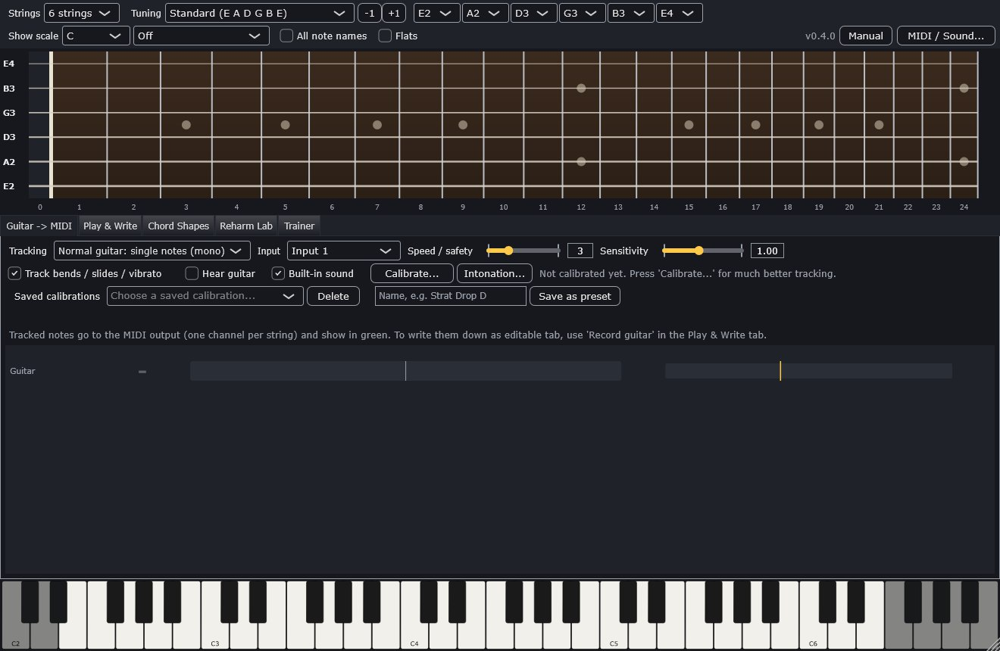

# Guitar Lab

A VST3 plugin (and standalone app) for Windows that turns a real guitar into MIDI, and adds practice and
writing tools around one shared fretboard (6, 7 or 8 strings, any tuning).



## What it does

- **Guitar -> MIDI**: tracks your guitar from the audio input and plays any synth or sampler in your DAW.
  Single notes (*Mono*), chords (*Poly*), or one input per string (*Hex* pickup). Bends, slides and vibrato
  are sent per string (one MIDI channel per string, MPE). A step-by-step calibration learns your guitar.
- **Play & Write**: write guitar phrases with hammer-ons, pull-offs, bends, slides, palm mute and more, or
  record your playing straight into editable tab. Export as MIDI, PDF, text tab, MusicXML or Guitar Pro 3.
- **Chord Shapes**: type any chord (`Cmaj7`, `F#m7b5`, `D/F#`) and see every playable shape.
- **Reharm Lab**: type a progression and get substitutions with playable, voice-led voicings.
- **Trainer**: note, interval and ear-training quizzes that focus on your weak spots.

## Download

Get the latest version from the [Releases](https://github.com/kuzunlu/guitar-lab/releases) page:

- `Guitar-Lab-Setup-X.Y.Z.exe` installs the VST3 plugin and the standalone app.
- `Guitar-Lab-vX.Y.Z.zip` has the same files without an installer.

The files are not signed, so Windows SmartScreen will show a warning the first time.

The user manual (`Manual/index.html`) comes with every download. The **Manual** button in the plugin opens it.

## Using it in a DAW

Guitar Lab is an **audio effect** with MIDI out. Put it on the audio track your guitar is plugged into.
To play another instrument, make a MIDI track and set its MIDI input to Guitar Lab
(Ableton: *MIDI From* = the guitar track, second box = *Guitar Lab*).

## Building from source

Needs Windows, Visual Studio Build Tools (C++), and CMake. JUCE 9.0.5 is downloaded by CMake
(you need your own JUCE licence, or use JUCE under the AGPLv3).

```
build.bat
```

This builds the plugin, the standalone app and the tests, and runs the tests.
The outputs are in `build/GuitarLab_artefacts/Release/`.

## Licence

The plugin and app are free to download and use. The source code is published to read, all rights reserved:
see [LICENSE](LICENSE). Guitar Lab is built with [JUCE](https://juce.com), used under the JUCE 9 Starter licence.
